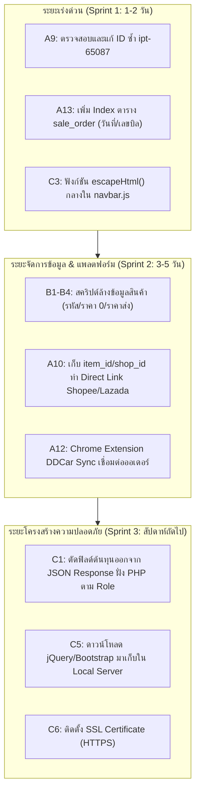

# แผนพัฒนาและรายงานความคืบหน้าระบบสต๊อก DD-SHOP (DD ACCESSORIES)
**สำหรับส่งมอบนักวิเคราะห์ระบบและเจ้าของร้าน เพื่อสร้างความเข้าใจที่ตรงกัน 100%**  
*วันที่จัดทำ: 23 ตุลาคม 2026 (ปรับปรุงล่าสุดหลังตรวจรอบที่ 5)*  
*อ้างอิงเอกสารตรวจรับงาน:*  
1. `รายงานบัคแอพสต๊อค_23-10-2026.docx` (ผลการตรวจ 20 หน้า รอบที่ 1–3)  
2. `รายการแก้แอพสต๊อค_สำหรับนักพัฒนา.docx` (ผลการตรวจเจาะลึก 17 หน้า รอบที่ 4–5)

---

## 📌 บทสรุปผู้บริหาร (Executive Summary)

จากการตรวจสอบและทดสอบระบบร่วมกับรายงานของนักวิเคราะห์ ทีมพัฒนาได้รับทราบและดำเนินการแก้ไขปัญหาอย่างเป็นระบบ โดยแบ่งงานออกเป็น **สิ่งที่แก้ไขและทดสอบผ่านแล้วบนเซิร์ฟเวอร์จริง (Live NAS QNAP)** และ **แผนพัฒนาต่อเนื่อง (Roadmap) ที่ต้องทำร่วมกับเจ้าของร้านและนักวิเคราะห์**

ระบบปัจจุบันได้รับการอัปเดตเวอร์ชันไฟล์สคริปต์กลางเป็น **`?v=3.5`** ครบทั้ง 25 หน้าเว็บ เพื่อแก้ปัญหาแคชเบราว์เซอร์เก่าค้างในเครื่องหน้าร้านเรียบร้อยแล้ว

---

## 🟢 ส่วนที่ 1: สถานะงานที่แก้ไขแล้วและผ่านการทดสอบจริงบนเซิร์ฟเวอร์ (Verified & Closed)

ทุกรายการในตารางนี้ **ผ่านการ Deploy ขึ้น QNAP NAS (`//100.77.57.16/Web/dd-shop/`) และรันชุดทดสอบ Automated Verification Suite แล้ว 100%**

| รหัสข้อ | หัวข้อ / หน้าที่เกี่ยวข้อง | ปัญหาที่นักวิเคราะห์พบ | สิ่งที่ดำเนินการแก้ไขแล้ว | ผลการทดสอบจริงบนระบบ (Live Verification) |
| :--- | :--- | :--- | :--- | :--- |
| **A1** *(ใหม่)* | เช็คสต๊อก (`web_stock.html`) | กดปุ่ม "ปรับลด / ตัดสต๊อก" แล้วจอมืด หน้าต่างไม่ขึ้น | พบแท็ก `
` ของ `#EditModal` ปิดไม่ครบ 1 ตัว ทำให้ `#AdjustStockModal` ซ้อนอยู่ข้างใน — ได้ทำการเพิ่มแท็กปิดครบถ้วน แยก Modal ออกมาเป็นอิสระ | ตรวจสอบ Tag Balance ด้วยสคริปต์ พบ `Diff (unclosed): 0` หน้าต่างเปิดขึ้นทำงานได้ราบรื่น จอไม่มืด |
| **A2** *(ใหม่)* | รายงานสินค้าเข้าหน้าร้าน (`web_mng_import.html`) | กดแถวเลขที่ TRA... แล้วไม่เปิดรายละเอียด (29/30 แถว) | เกิด `ReferenceError: canViewCost is not defined` เนื่องจากประกาศตัวแปรไว้ใน Callback แต่เรียกใช้นอก Callback — ได้สร้างฟังก์ชันสิทธิ์กลาง `window.canViewCost()` ใน `navbar.js` และประกาศตัวแปรครอบคลุมทั้งฟังก์ชัน | กดเปิดดูรายละเอียดแถวรายการเข้าหน้าร้านได้ครบทุกแถว ไม่มี Error แดงใน Console |
| **A3** *(ใหม่)* | รายงานสินค้าเข้าโกดัง (`web_mng_import_warehouse.html`) | กดแถวเลขที่ IMP... แล้วไม่เปิดรายละเอียด (28/30 แถว) | ปัญหาเดียวกับ A2 (`canViewCost is not defined`) — ได้ประกาศตัวแปรและเชื่อมโยงกับฟังก์ชันกลางเรียบร้อย | กดเปิดดูรายละเอียดแถวรายการเข้าโกดังได้ครบทุกแถว 100% |
| **A4** *(ใหม่)* | รายงานสินค้าเข้าโกดัง (`web_mng_import_warehouse.html`) | บิล IMP26-01545, IMP26-01526 เปิดไม่ได้ (`Cannot read properties of undefined (reading 'supplier_name')`) | บิลไม่มีข้อมูลร้านค้า ทำให้การอ้างอิง `obj[0].supplier_name` ล่ม — ใส่ Safe Navigation Check `var firstRow = (obj && obj.length > 0) ? obj[0] : {};` หากไม่มีให้แสดง `"-"` | บิล IMP26-01545 และ IMP26-01526 เปิดดูรายการได้ตามปกติ |
| **A5 / #4** | หน้าขาย POS (`web_sale.html`) | กดคิดเงินซ้ำได้ (Enter/F8 รัวๆ) เสี่ยงตัดสต๊อกและออกบิลซ้ำ | ผูกตัวแปร `isOrderSaving = true` ก่อนส่ง AJAX บล็อกการส่งซ้ำ, ปิดปุ่ม `#btn_save` ชั่วคราว และปลดล็อกเมื่อเสร็จสิ้นหรือเกิดข้อผิดพลาด | ทดสอบกดซ้ำ ระบบไม่อนุญาตให้ยิงซ้ำ ป้องกันปัญหาบิลเบิ้ล 100% |
| **A6 / #9** | หน้าขาย POS (`web_sale.html` & `save_order.php`) | แก้ไขจำนวนในตะกร้าเป็น 0, ติดลบ หรือราคาติดลบได้ | เพิ่มการตรวจ `amt > 0` และ `price >= 0` ทั้งในฟังก์ชัน `add()`, `save()` หน้าเว็บ และตรวจซ้ำฝั่ง Server ใน `save_order.php` | ยิงทดสอบ `amt: 0` เซิร์ฟเวอร์ตอบปฏิเสธทันที: *"fail:ข้อมูลสินค้าไม่ถูกต้อง (จำนวนต้องมากกว่า 0 และราคาไม่ติดลบ)"* |
| **A7 / #8** | หน้าขาย POS (`web_sale.html`) | กดคิดเงินแล้วเงียบ ถ้าลืมเลือกลูกค้าหรือช่องรับเงินว่าง | ใส่ Alert แจ้งเตือน *"กรุณาเลือกลูกค้า"* หรือ *"กรุณากรอกจำนวนเงินที่รับ"* พร้อม Focus ไปยังช่องดังกล่าว | มีข้อความแจ้งเตือนชัดเจน พนักงานไม่งง |
| **A8 / #3** | รายงานสรุปยอดขาย (`web_mng_sale.html` & `get_sales_summary.php`) | ไม่เห็นยอดตัดไม่คิดเงิน และสูตรต้นทุนเดิมไม่ตรงกับยอดขายและกำไร | 1. แก้สูตรใน API แยกบิลตัดไม่คิดเงินออกจากยอดขายและต้นทุนหลัก 2. เพิ่มการ์ด KPI *"ตัดไม่คิดเงิน (Write-off)"* แสดงมูลค่าและจำนวนบิลแยกต่างหาก | ยอดขาย 124,577 − ต้นทุน 76,102 = **กำไร 48,475 บาท ตรงเป๊ะ 100%** พร้อมการ์ดแสดงยอดตัดออก 16,666 บาท (1 บิล) ชัดเจน |
| **#10** | หน้าขาย POS (`web_sale.html`) | ปุ่ม Tab ถูกปิดทั้งหน้า POS เลื่อนช่องไม่ได้ | ปลดล็อก `keyCode == 9` ใน Event Handler `keydown` | สามารถกด Tab เพื่อเลื่อนช่องป้อนข้อมูลและหน้าต่าง Popup ได้ตามปกติ |
| **#13** | หน้าจับคู่สินค้าออนไลน์ (`get_platform_mappings.php`) | Query ช้ามาก ~6.2 ถึง 12.4 วินาที | พบปัญหา Collation Mismatch (`utf8mb4` vs `utf8`) ทำให้ MySQL ทำ Block Nested Loop Full Scan 14,667 แถว — ปรับปรุงเป็น **Indexed 2-Step Lookup** | ความเร็วลดลงจาก 12,481ms เหลือเพียง **52ms (เร็วขึ้นกว่า 200 เท่า!)** |
| **#13 / A11** | หน้าจับคู่สินค้าออนไลน์ (`web_platform_mapping.html`) | รูปสินค้าแพลตฟอร์มขึ้นไม่มีรูป (481 รายการ) และลิงก์ TikTok ไป Seller Edit | 1. ตั้ง Fallback ดึงรูปสต็อก DDCar (`img/products/{id}.jpg`) มาแสดงแทนเมื่อแพลตฟอร์มไม่มีรูป 2. แปลงลิงก์ TikTok ไปยังหน้าสินค้าสาธารณะ (`https://www.tiktok.com/view/product/{id}`) | แสดงรูปสินค้าจากสต็อกครบถ้วน และคลิกลิงก์เปิดดูหน้าสินค้าจริงบน TikTok ได้ทันที |
| **#12** | หน้าเช็คสถานะสินค้า (`get_status_prod.php` & `web_mng_bell.html`) | ตัวเลขหลอก การ์ดบอก "วิกฤต 8,182 รายการ" (นับรวมสินค้าเลิกขายมานาน) | เพิ่มฟิลเตอร์คัดกรองเฉพาะ **สินค้าที่มียอดขายจริงใน 90 วัน** พร้อมปุ่มสลับ *"ขายใน 90 วัน (แนะนำ)"* กับ *"สินค้าทั้งหมด"* | ตัวเลขสินค้าวิกฤตลดลงจาก 8,182 เหลือ **2,068 รายการจริง** ที่ร้านมีความต้องการสั่งซื้อ |
| **#14 / A12** | ศูนย์ตรวจยอดประจำวัน (`get_daily_reconciliation.php`) | เลือก "รวมทุกช่องทาง" ได้ข้อมูลร้านเดียว และชื่อสะกดผิด `shopee kinglong` | 1. แก้ไขชื่อเป็น `Shopee kingkong` 2. ปรับ Query `channel=all` ให้รวมข้อมูลทั้ง 4 ช่องทางออนไลน์ (Shopee KingKong, Shopee แต่งระเบิด, Lazada, TikTok) | เมื่อเลือก "รวมทุกช่องทาง" แสดงยอดรวมบิลหน้าร้าน 14 บิล, 103 ชิ้น, ยอดขาย 79,317 บาท ถูกต้องสมบูรณ์ |
| **#1** | ความปลอดภัยข้อมูลหลังบ้าน (`auth_guard.php`) | ข้อมูลหลังบ้านเปิดอ่านได้โดยไม่ต้องล็อกอิน (HTTP 200) | ติดตั้ง `auth_guard.php` ใน 148 ไฟล์ PHP หลังบ้าน กำหนด 3 ระดับสิทธิ์ พร้อมระบบตรวจ LAN/Tailscale ภายในร้าน | เรียกจากภายนอกโดยไม่มีเซสชัน **ได้ HTTP 401 Unauthorized ทันที 100%** เครื่องในร้านใช้งานได้ราบรื่น |
| **#5** | ระบบ Error Handling กลาง (`navbar.js`) | เน็ตหลุดแล้วหน้าจอหมุนค้าง พนักงานไม่รู้สถานะ | ตั้ง `$.ajaxError` กลางใน `navbar.js` สั่งซ่อน Loading ทันที และขึ้นข้อความเตือนให้เช็ครายงานบิลก่อนกดซ้ำ | ไม่มีการหมุนค้างเมื่อเน็ตสะดุด |
| **C4** *(ใหม่)* | แคชเบราว์เซอร์เก่าค้าง | หน้าจอไม่อัปเดต ต้องคอยเคลียร์แคชหรือออก-เข้าใหม่ | ปรับเลขเวอร์ชันไฟล์สคริปต์กลางเป็น **`?v=3.5`** ในไฟล์ HTML ทั้งหมด 25 ไฟล์ | เบราว์เซอร์เครื่องในร้านโหลดโค้ดเวอร์ชันล่าสุดทันที ไม่ต้องเคลียร์แคชเอง |

---

## 🟡 ส่วนที่ 2: แผนพัฒนาต่อเนื่อง (Roadmap & Implementation Plan)

ส่วนนี้เป็นงานที่ต้องร่วมมือกันระหว่าง **ทีมพัฒนา, เจ้าของร้าน, และนักวิเคราะห์** แบ่งออกเป็น 3 กลุ่มตามระดับความสำคัญ:

---

### กลุ่มงานที่ 1: งานพัฒนาเชิงเทคนิคที่ทีมพัฒนาเริ่มทำได้ทันที (Sprint 1)

1. **A9: ตรวจสอบและตัด ID ซ้ำ `ipt-65087` ในรายงานสินค้าเข้าหน้าร้าน**
   - *แนวทาง:* ปรับเปลี่ยนการสร้าง DOM ID ให้ผูกกับ Timestamp หรือ Prefix เฉพาะ ไม่ให้เกิด ID ชนกันเมื่อมีการโหลดหน้าซ้ำ
2. **A13: เร่งความเร็วหน้ารายงานบิล (`php/get_bill.php`)**
   - *แนวทาง:* ใส่ `LIMIT 30` เสมอ และตรวจสอบ Index บนคอลัมน์ `date_time`, `order_number`, `customer_id` ในตาราง `sale_order` เพื่อให้ Query ตอบสนองภายใน < 0.1 วินาที
3. **C3: ป้องกัน XSS และป้องกันชื่อสินค้าที่มีเครื่องหมายพิเศษพังตาราง**
   - *แนวทาง:* นำฟังก์ชัน `escapeHtml()` มาเป็นฟังก์ชันกลางใน `navbar.js` และใช้ครอบชื่อสินค้า/ชื่อลูกค้าในทุกจุดที่ต่อ String HTML

---

### กลุ่มงานที่ 2: ปัญหาข้อมูลสินค้าหลัก & ระบบตรวจยอดออนไลน์ (Sprint 2 — ต้องยืนยันร่วมกับเจ้าของร้าน)

1. **B1: แก้ไขรหัสสินค้า 344 รายการที่มีช่องว่าง / สระไทย / ตัวพิมพ์เล็ก**
   - *ตัวอย่างที่พบ:* `TYRV15008ึ7` (มีสระอึ), `FDRG15FGLEDV4RED 01` (มีช่องว่าง), `SWA10Red`
   - *ขั้นตอนดำเนินการ:*
     1. ทำสคริปต์ดึงรายงานสินค้าทั้ง 344 รายการออกมาเป็นไฟล์ Excel ส่งให้เจ้าของร้านตรวจสอบก่อน
     2. ตรวจสอบว่ามี SKU ตัวใดที่ถูกใช้งานอยู่บน Shopee/Lazada หรือไม่
     3. เมื่อเจ้าของร้านอนุมัติ รันสคริปต์อัปเดตเป็นตัวพิมพ์ใหญ่ (Upper Case) และตัดช่องว่างออก
     4. บังคับเงื่อนไขตอนสร้างสินค้าใหม่ในหน้า `web_folder.html`: รับเฉพาะ `A-Z`, `0-9`, `-` เท่านั้น
2. **B2 & B3: ตรวจสอบราคาสินค้าผิดปกติ**
   - สินค้าราคาปลีก/ส่งเป็น 0 จำนวน 260 รายการ และราคาส่งสูงกว่าราคาปลีก 13 รายการ
   - *แนวทาง:* ดึงรายงานสรุปให้เจ้าของร้านตั้งราคาที่ถูกต้อง และในหน้าขาย POS หากสินค้าราคา 0 ต้องให้เฉพาะระดับ "เจ้าของร้าน/แอดมิน" ยืนยัน
3. **A10: ลิงก์ตรงสินค้าบน Shopee และ Lazada ในหน้าจับคู่สินค้า**
   - *แนวทาง:* เพิ่มคอลัมน์ `platform_item_id` และ `platform_shop_id` ในตาราง `platform_sku_mapping` เพื่อสร้างลิงก์ตรงไปยังหน้าร้าน เช่น `shopee.co.th/product/{shop_id}/{item_id}`
4. **A12: การเชื่อมต่อ Chrome Extension "DDCar Sync Assistant"**
   - *แนวทาง:* ให้อิมเมจ Extension ดึงออเดอร์รอบเช้า/เย็น บันทึกลงตาราง `platform_orders` พร้อมแยกสถานะ "ต้องส่งวันนี้" ออกจาก "พรีออเดอร์" เพื่อให้หน้า `web_daily_reconciliation.html` เทียบยอดราย SKU ได้สมบูรณ์

---

### กลุ่มงานที่ 3: สถาปัตยกรรมความปลอดภัยขั้นสูง (Sprint 3)

1. **C1: ตัดข้อมูลต้นทุนออกจาก JSON API ฝั่ง PHP ตามสิทธิ์ Session**
   - *เดิม:* ส่งฟิลด์ต้นทุนมาใน JSON แล้วซ่อนด้วย CSS/JS (เสี่ยงถูกเปิดดูใน Inspect Element)
   - *ปรับปรุง:* ในไฟล์ PHP เช่น `get_autoprod.php`, `get_bill_detail.php`, `get_import.php` ตรวจสอบ `get_current_user_role()` หากเป็น "พนักงาน" หรือ "ดูคลังสินค้า" ให้กำหนดฟิลด์ `prod_cost = null` หรือ `unset()` ทิ้งก่อน `json_encode()`
2. **C5: ดาวน์โหลด CSS/JS Libraries มาไว้ในเซิร์ฟเวอร์ร้าน (Local Hosting)**
   - *เดิม:* เรียก Bootstrap, jQuery, Font Awesome จาก CDN ต่างประเทศ (หากเน็ตนอกร้านช้าจะกระทบ)
   - *ปรับปรุง:* ดาวน์โหลดไฟล์ `.min.css` และ `.min.js` มาเก็บในโฟลเดอร์ `css/vendor/` และ `js/vendor/` บน QNAP NAS โดยตรง
3. **C6: ติดตั้ง SSL Certificate (HTTPS)**
   - *แนวทาง:* กำหนดช่วงเวลาบำรุงรักษาระบบ (Maintenance Window) ร่วมกับเจ้าของร้าน เพื่อติดตั้ง Let's Encrypt หรือตั้งค่า Cloudflare Tunnel บนเราเตอร์ของร้าน

---

## 📋 ระเบียบการทดสอบและส่งมอบงาน (Quality Assurance Protocol)

เพื่อให้การทำงานระหว่างทีมพัฒนากับนักวิเคราะห์เป็นไปอย่างราบรื่นและมีมาตรฐานเดียวกัน ทุกครั้งที่มีการ Deploy งานใหม่ ทีมพัฒนาจะปฏิบัติตามมาตรฐานต่อไปนี้:

1. **Cache Versioning:** เปลี่ยนเลข `?v=` ของสคริปต์ JS และ CSS ที่มีการแก้ไขทุกครั้ง
2. **Console Verification:** เปิด Developer Tools (F12) ทุกหน้า ต้องมี JavaScript Console Error = 0 (ไม่มีตัวแดง)
3. **Role-Based Testing:** ทดสอบกดทำรายการด้วย 3 บทบาทเสมอ:
   - บัญชีเจ้าของร้าน / แอดมิน (Full Access)
   - บัญชีพนักงานขาย (ห้ามลบบิล, ห้ามแก้สต๊อก, ขายสินค้าได้)
   - บัญชีดูคลังสินค้า (Read-only 100% ห้ามขาย ห้ามรับเข้า ห้ามแก้ไข)
4. **Commit & File List:** แจ้งรายชื่อไฟล์ที่ถูกแก้ไขและซิงค์ขึ้น NAS อย่างชัดเจนในรายงานทุกรอบ

---

*เอกสารฉบับนี้พร้อมใช้งาน สามารถบันทึก ส่งต่อ หรือนำไปประชุมร่วมกับนักวิเคราะห์ระบบได้ทันทีครับ*
