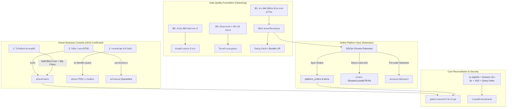

# แผนพัฒนาและยกระดับระบบ DD-Shop ฉบับบูรณาการ (V3.0 Master Roadmap)
**วันที่ปรับปรุง:** 24 ตุลาคม 2026  
**สำหรับ:** เจ้าของร้าน, นักพัฒนาระบบ, และผู้ตรวจสอบระบบอิสระ (Analyst)  
**ระบบเป้าหมาย (Live System):** `http://ddaccessory.trueddns.com:24330/dd-shop/`  
**เซิร์ฟเวอร์ฐานข้อมูลและไฟล์:** QNAP NAS (`100.77.57.16:8083` / SMB `//100.77.57.16/Web/dd-shop/`)

---

## 📌 บทนำและคำชี้แจง: การบูรณาการข้อเสนอทั้งหมด ไม่ตกหล่นแม้แต่ข้อเดียว

จากข้อสั่งการของเจ้าของร้าน:
> *"มันมีส่วนที่นักพัฒนาเค้าแจ้งว่าตกหล่นตอนด้วย ไม่เห็นในแผนพัฒนาเลยนะ เช่น แก้ extension อะไรพวกนี้ อย่าตกหล่นสิ่งที่เค้าเสนอสิ เอามาวิเคราะห์ และปรับลงแผนพัฒนาด้วย"*

ทีมพัฒนาได้นำข้อเสนอแนะทางเทคนิคที่เคยนำเสนอไว้ทั้งหมด (Chrome Extension, Data Cleansing, Query Indexing, DOM collision, XSS Escaping, Local Libraries, Security Hygiene) มาร้อยเรียงเชื่อมโยงเข้ากับ **3 ภารกิจหลักที่เจ้าของร้านยืนยันล่าสุดเมื่อ 24/10/2026** (ใบรับของเข้ารออนุมัติ, ราคาขายส่ง 3–5 อันดับ, รับคืน/เคลม ระยะ A) เกิดเป็น **แผนพัฒนาฉบับบูรณาการ V3.0 (Unified Master Roadmap)** เพื่อให้ทุกฝ่ายเห็นภาพตรงกัน 100% ก่อนลงมือเขียนโค้ดจริง

---

## 1. บทวิเคราะห์เชิงลึก: ทำไมส่วนที่นักพัฒนาเสนอจึงเป็นจิ๊กซอว์ที่ขาดไม่ได้



### 1.1 ประเด็น Chrome Extension (A12) — ทำไมถึงต้องแก้ และกระทบระบบอย่างไร?
* **ปัญหาที่ตรวจพบจริงบนระบบสด:**
  1. ในหน้าศูนย์ตรวจยอดประจำวัน (`get_daily_reconciliation.php`) ฝั่งแพลตฟอร์มขึ้นยอดเป็น 0 (`last_synced_at = null`) ทั้งที่หน้าร้านมีการตัดขายออนไลน์แล้ว 16 บิล (109 ชิ้น)
  2. **สาเหตุทางเทคนิคระดับโค้ด:** ในไฟล์ `background.js` ของส่วนขยาย มีการส่ง Header `X-Extension-Request: ddcar_extension` แต่ในระบบป้องกัน `auth_guard.php` กำหนดให้ตรวจสอบ `X-Extension-Token: DDCar_Sync_Token_2026_xK9$pL` ทำให้เมื่อ Extension พยายามยิงข้อมูลเข้า `sync_platform_orders.php` จึงถูกระบบปฏิเสธ (401 Unauthorized)
  3. **การเข้าถึงหลายร้านพร้อมกัน (Multi-Shop Profile):** ปัจจุบันร้านมีบัญชีร้านค้า 2 ร้านบน Shopee (KingKong และ แต่งระเบิด), Lazada, และ TikTok หากเปิดในหน้าต่าง Chrome เดียวกัน คุกกี้จะตีกันหลุดล็อกอิน จึงจำเป็นต้องใช้สถาปัตยกรรม **Chrome Profiles** แยกแต่ละร้านอย่างเด็ดขาด
  4. **การเชื่อมโยงกับฟีเจอร์อื่นๆ:**
     - **A10 ลิงก์ตรงสินค้า:** ต้องให้ Extension ดึง `item_id` และ `shop_id` ของ Shopee/Lazada บันทึกเข้าตาราง `platform_sku_mapping` เพื่อให้หน้าเว็บกดลิงก์ไปยังหน้ารายการสินค้าจริงบน Shopee (`shopee.co.th/product/{shop_id}/{item_id}`) ได้โดยตรง ไม่ใช่หน้าค้นหา
     - **การคัดแยกพรีออเดอร์:** Extension ต้องตรวจจับป้าย `[Pre-order]` ในออเดอร์แพลตฟอร์ม เพื่อไม่นำมารวมในยอดตัดสต๊อกพร้อมส่งประจำวัน
     - **สินค้าคู่ (Bundle L/R):** ออเดอร์แพลตฟอร์มที่เป็นชุดคู่ ต้องแตก BOM ไปตัดสต๊อกซ้ายและขวาอัตโนมัติ

### 1.2 ประเด็นคุณภาพข้อมูลสินค้า (Data Cleansing B1–B4)
การที่ระบบสต๊อกเกิดความคลาดเคลื่อนและ Extension จับคู่ไม่เจอ ไม่ได้เกิดจากบัคหน้าจอเพียงอย่างเดียว แต่เกิดจาก **"ข้อมูลขยะ"** ในตาราง `product`:
* **B1 (344 รายการ):** รหัสสินค้ามีช่องว่าง, ตัวพิมพ์เล็ก, หรือมีสระภาษาไทยปน เช่น `TYRV15008ึ7` (มีสระอึ), `FDRG15FGLEDV4RED 01` (มีเว้นวรรค) ส่งผลให้เครื่องสแกนบาร์โค้ดอ่านไม่ตรง และระบบ Matching แพลตฟอร์มหาคู่ไม่พบ
* **B2 (260 รายการ):** สินค้าราคาขายปลีกและราคาส่งเป็น 0 บาท หากพนักงานเผลอกดขายจะทำให้เกิดความเสียหายทันที ต้องกักกันและใส่ตัวบล็อกห้ามขายราคา 0
* **B3 (13 รายการ):** ราคาส่งสูงกว่าราคาปลีก (กรอกข้อมูลสลับช่อง)
* **B4 (9 รายการ):** สินค้าใกล้หมดแต่ไม่มีต้นทุน ทำให้สูตรคำนวณกำไรเพี้ยน

### 1.3 ประเด็นโครงสร้างและประสิทธิภาพ (A9, A13, C1, C3, C5, C6)
* **A9:** ปัญหา DOM ID ชนกัน (`ipt-65087`) ในหน้ารายงานสินค้าเข้าหน้าร้าน ทำให้ JavaScript selector ทำงานผิดแถว
* **A13:** หน้ารายงานบิล (`web_mng_bill.html` / `get_bills.php`) โหลดข้อมูลทั้งหมดโดยไม่มี LIMIT และขาด Database Indexing ทำให้หน่วง ~1 วินาที และจะช้าลงเรื่อยๆ เมื่อบิลมีจำนวนมากขึ้น
* **C1:** การตัดต้นทุนสินค้าออกจาก Response API ฝั่ง PHP ตาม Session Role เพื่อป้องกันพนักงานกด F12 Inspect ดูต้นทุนและกำไร
* **C3:** ป้องกันช่องโหว่ Cross-Site Scripting (XSS) ด้วยการนำ `escapeHtml()` มาใช้กับชื่อสินค้าและชื่อลูกค้าในทุกหน้าจอ (หน้าขาย, สต๊อก, รายงานบิล, นำเข้า)
* **C5:** ย้ายไลบรารี jQuery, Bootstrap, FontAwesome มาเก็บไว้บน Local NAS เพื่อให้ระบบทำงานได้เสถียรแม้เน็ตภายนอกขัดข้อง

---

## 2. ตารางแผนงานบูรณาการ V3.0 (Master Unified Roadmap)

| ระยะ (Phase) | รายการงาน | รายละเอียดและการเชื่อมโยง | สถานะ | กำหนดเสร็จ |
|---|---|---|:---:|:---:|
| **Phase 0**<br>(ด่วนวันนี้) | **สุขอนามัยความปลอดภัยเร่งด่วน** | • ลบ `phpinfo.php` ออกจาก Web Root ทั้ง 2 จุด<br>• ปรับ Session Lifetime ให้หมดอายุสิ้นวัน (Midnight Expiry 23:59:59) เพื่อความปลอดภัย<br>• ลบบัญชีทดสอบและปรับปรุงรหัสผ่านระบบ | ⏳ รอทำ | 24 ต.ค. 2026 |
| **Phase 1**<br>(ทำทันที) | **ระบบรับคืน / เคลม (ระยะ A)** | • เมนูใหม่ `RT26-xxxxx` ไม่แก้บิลเดิม<br>• ดึงเลขอ้างอิงบิลขาย หรือ เลขคำสั่งซื้อแพลตฟอร์ม<br>• ทางเลือก 2 ทาง: คืนเข้าสต๊อกขาย vs เข้า **"คลังรอเคลม"**<br>• ช่องพิมพ์เหตุผลอิสระ + วงจรชีวิตเคลม 3 สถานะ<br>• ลงย้อนหลังได้เพื่อเคลียร์ของค้างหน้าร้าน<br>• ปิดปุ่มคืนเดิม + แก้บักปัดเศษสตางค์ | ⏳ รอทำ | 25 ต.ค. 2026 |
| **Phase 2**<br>(คุมเงิน/ทุจริต) | **ใบรับสินค้าเข้ารออนุมัติ + คุมตัดสต๊อก** | • พนักงานลงรับของ: บังคับแนบรูปบิล + รูปสินค้า (Blind Cost ไม่เห็นทุน)<br>• แจ้งเตือน Badge รออนุมัติบนเมนูผู้บริหาร<br>• แอดมิน/เจ้าของร้าน ตรวจรูป vs รายการ, ดูทุนเดิม, เตือนทุนต่าง ±5%<br>• อนุมัติ -> สต๊อกเพิ่ม / ตีกลับระบุเหตุผล<br>• บรรจุระบบอนุมัติบิลตัดไม่คิดเงิน (Write-off) และปรับลดสต๊อก | ⏳ รอทำ | 26 ต.ค. 2026 |
| **Phase 3**<br>(ระบบออนไลน์) | **ยกระดับ Chrome Extension & ตรวจยอด** | • แก้ Token `X-Extension-Token` ใน `background.js`<br>• กำหนด Host Permissions รองรับ TrueDDNS & Local IP<br>• รองรับ Chrome Profiles (KingKong, แต่งระเบิด, Lazada, TikTok)<br>• **A10:** ดึง item_id ทำลิงก์ตรงสินค้าบนแพลตฟอร์ม<br>• **A11:** ดึงรูปสินค้าและจัดการภาพแสดงผล<br>• คัดแยกสินค้า Pre-order ออกจากยอดพร้อมแพ็ก<br>• ศูนย์ตรวจยอดประจำวันกระทบยอด 3 กลุ่ม (Matched, Discrepant, Unmapped) | ⏳ รอทำ | 27 ต.ค. 2026 |
| **Phase 4**<br>(สนับสนุนขายส่ง) | **ราคาขายส่งต่ำสุด 3–5 อันดับ** | • คำนวณราคาส่งย้อนหลัง 12 เดือน (ราคาล่าสุดต่อร้าน เรียงต่ำไปสูง)<br>• แสดงบนการ์ดสินค้าหน้าเช็คสต๊อก (ปุ่ม "ประวัติ")<br>• แสดงบนหน้าขาย POS อัตโนมัติเมื่อเลือกลูกค้าขายส่ง<br>• แจ้งเตือนทันทีเมื่อพนักงานใส่ราคาต่ำกว่าอันดับ 1 หรือต่ำกว่าราคาส่งมาตรฐาน<br>• ตัดข้อมูลที่ API ฝั่ง PHP ตามสิทธิ์ Session (เฉพาะแอดมิน/เจ้าของร้าน) | ⏳ รอทำ | 28 ต.ค. 2026 |
| **Phase 5**<br>(โครงสร้าง & ฐานข้อมูล) | **สินค้าคู่ + ล้างข้อมูล + บูรณะเทคนิค** | • **5.1 Bundle L/R:** แตก BOM สินค้าคู่ ตัดสต๊อกซ้าย/ขวาอัตโนมัติ<br>• **5.2 Data Cleansing (B1–B4):** สคริปต์ปรับรหัส 344 รายการ, กักกัน 260 สินค้าราคา 0, แก้งานราคาส่งผิด<br>• **5.3 ประสิทธิภาพ:** แก้ DOM ID ชน (A9), ใส่ Indexing + LIMIT 30 บิล (A13)<br>• **5.4 ความปลอดภัย:** Global XSS `escapeHtml()` (C3), เก็บ Local Libraries (C5), ติดตั้ง HTTPS (C6)<br>• **5.5 รับคืน/เคลม (ระยะ B):** แบบฟอร์มใบลดหนี้ผ่านบัญชี + สรุปภาษีขาย | ⏳ รอทำ | 29–31 ต.ค. 2026 |

---

## 3. รายละเอียดเจาะลึกแต่ละฟังก์ชัน (Specifications)

### 3.1 ฟังก์ชันรับคืน / เคลม — ระยะ A (Return & Claim Phase A)
* **รหัสเอกสาร:** `RT26-xxxxx` ออกอัตโนมัติเรียงลำดับต่อเนื่อง ไม่แก้ไขหรือลบบิลขายเดิม
* **การอ้างอิง:** 
  - ใส่เลขที่บิลขายหน้าร้าน หรือ เลขคำสั่งซื้อแพลตฟอร์ม (Shopee / Lazada / TikTok)
  - ระบบดึงรายการสินค้า, ลูกค้า, ยอดเงิน และสถานะ VAT มาแสดงอัตโนมัติ
  - กรณีไม่มีเอกสารอ้างอิง: อนุญาตให้บันทึกเพื่อควบคุมสต๊อกสินค้าได้ แต่จะล็อกไม่ให้ออกใบลดหนี้
* **การแยกปลายทางสินค้า (2 ทางเด็ดขาด):**
  1. `คืนเข้าสต๊อกพร้อมขาย`: สินค้าสภาพสมบูรณ์ สต๊อกในคลังที่ระบุจะเพิ่มขึ้นทันที
  2. `เข้าคลังรอเคลม (Quarantine)`: สินค้าชำรุด แตกหัก เสียหาย สต๊อกจะวิ่งเข้าคลังแยกพิเศษ ไม่นำไปนับเป็นสต๊อกพร้อมขาย
* **วงจรชีวิตสินค้าในคลังรอเคลม (Claim Lifecycle):**
  `รอส่งเคลมซัพพลายเออร์` ➔ `ส่งเคลมแล้ว (รอผล)` ➔ `ปิดรายการ (ได้ของใหม่ / ได้รับใบลดหนี้ / เคลมไม่ได้-ตัดทิ้ง)`
* **การจัดการด้านการเงิน:**
  - ตัวเลือก: คืนเงินสด / โอนเงินคืน / หักลดยอดหนี้ (เครดิต) / เปลี่ยนเป็นสินค้าตัวอื่น / ไม่คืนเงิน (เช่น กรณีพัสดุตีกลับจากขนส่ง)
* **การจัดการภาษีมูลค่าเพิ่ม (VAT):**
  - บิลขายเดิมมี VAT ➔ ออกเอกสาร **ใบลดหนี้ (Credit Note)** มีข้อความครบถ้วนตามกฎหมายสรรพากร (ชื่อ ที่อยู่ เลขประจำตัวผู้เสียภาษี เลขที่ใบกำกับเดิม มูลค่าเดิม ผลต่าง และ VAT)
  - บิลขายเดิมไม่มี VAT ➔ ออกเอกสาร **ใบรับคืนสินค้าภายใน (Internal Return Slip)**
* **การบันทึกย้อนหลัง:** รองรับการระบุ "วันที่เกิดรายการจริง" เพื่อให้พนักงานนำสินค้าที่ค้างอยู่ในร้านมาลงระบบย้อนหลังให้ตรงความเป็นจริง

---

### 3.2 ฟังก์ชันใบรับสินค้าเข้ารออนุมัติ (Stock-In Approval Workflow)
* **ขั้นตอนที่ 1 (พนักงานลงรับ):**
  - เลือกสินค้า, จำนวน, ซัพพลายเออร์, เลขที่ใบส่งของ/บิล
  - **บังคับแนบรูปถ่าย 2 ส่วน:** 1) รูปถ่ายใบส่งของ/สลิปซัพพลายเออร์ 2) รูปถ่ายตัวสินค้าจริง
  - **Blind Cost:** หน้าจอพนักงานจะไม่เห็นช่องกรอกราคาทุน และ API จะไม่ส่งราคาทุนเดิมไปให้พนักงาน
* **ขั้นตอนที่ 2 (สถานะรออนุมัติ):**
  - บิลอยู่ในสถานะ `รออนุมัติ (Pending)` ตัวเลขสต๊อกยังไม่เพิ่มในคลัง
  - แสดงตัวเลขแจ้งเตือนสีแดง (Notification Badge) บนเมนูของผู้บริหาร
* **ขั้นตอนที่ 3 (ผู้บริหารตรวจสอบ):**
  - เจ้าของร้าน/แอดมิน เปิดดูรูปถ่ายใบส่งของเทียบกับตัวสินค้า (เช็กรุ่น สี ไซส์ จำนวน)
  - ระบบแสดง **"ราคาทุนครั้งล่าสุด + วันที่รับเข้าล่าสุด + ชื่อซัพพลายเออร์เดิม"**
  - เจ้าของร้านกรอกหรือยืนยันราคาทุนจริง
  - **ระบบแจ้งเตือนอัจฉริยะ:** หากราคาทุนใหม่ต่างจากทุนเดิมเกิน **±5%** ระบบจะแสดงไฮไลต์สีส้มเตือนทันทีเพื่อให้ตรวจสอบซ้ำ
* **ขั้นตอนที่ 4 (ผลการพิจารณา):**
  - `อนุมัติ`: สต๊อกเข้าคลังจริง บันทึกชื่อผู้อนุมัติ วันที่ และเวลา
  - `ตีกลับ`: ระบุเหตุผลข้อผิดพลาด (เช่น "ส่งผิดรุ่น ในรูปเป็นสีดำไม่ใช่สีชุบ") รายการจะเด้งกลับไปที่พนักงานเพื่อแก้ไข

---

### 3.3 ฟังก์ชันปรับปรุงและยกระดับ Chrome Extension "DDCar Sync Assistant" (A12, A10, A11)
* **การแก้ปัญหาการเชื่อมต่อและ Token:**
  - ปรับปรุง `background.js` ให้ส่ง Header:
    ```javascript
    headers: {
      "Content-Type": "application/json",
      "X-Extension-Request": "ddcar_extension",
      "X-Extension-Token": "DDCar_Sync_Token_2026_xK9$pL"
    }
    ```
  - ปรับปรุง `manifest.json` เพิ่ม `host_permissions` ให้ครอบคลุม:
    - `http://ddaccessory.trueddns.com:24330/*`
    - `http://100.77.57.16:8083/*`
    - `https://*/*`
* **การแยกร้านค้าด้วย Google Chrome Profiles:**
  - คู่มือแนะนำการสร้าง Chrome Profile แยกเด็ดขาด:
    - Profile 1: Shopee KingKong (ส้ม)
    - Profile 2: Shopee แต่งระเบิด (แดง)
    - Profile 3: Lazada (น้ำเงิน)
    - Profile 4: TikTok Shop (ดำ)
  - ป้องกันการหลุด Session และป้องกันคุกกี้ตีกัน 100%
* **การดึงข้อมูลขั้นสูง (A10 & A11):**
  - ดึง `platform_item_id` และ `platform_model_id` เพื่อสร้าง Direct URL ไปยังหน้าสินค้าบนแพลตฟอร์ม
  - ดึงรูปภาพสินค้า Thumbnail จากหน้าแพลตฟอร์มบันทึกเป็นรูปสำรอง (Fallback)
* **การคัดแยกพรีออเดอร์ (Pre-order Tagging):**
  - ตรวจจับข้อความระบุพรีออเดอร์ในหน้าคำสั่งซื้อ บันทึกสถานะ `is_preorder = 1` เพื่อไม่นำไปตัดสต๊อกพร้อมส่ง
* **รอบการซิงค์อัตโนมัติ:**
  - รอบเช้า: เมื่อเปิดเครื่องและเข้าหน้าจัดการคำสั่งซื้อ
  - รอบเย็น: 17:00 น. ก่อนสรุปยอดปิดร้าน

---

### 3.4 ฟังก์ชันราคาขายส่งต่ำสุด 3–5 อันดับ (Wholesale Price Benchmark)
* **ที่มาข้อมูล:** ค้นหาประวัติการขายย้อนหลัง 12 เดือน จากตาราง `sale_order` และ `sale_order_item` เฉพาะลูกค้ากลุ่มขายส่ง
* **หลักการเลือกราคา:** ดึงเฉพาะ **"ราคาขายครั้งล่าสุดของแต่ละร้านค้า"** (ไม่ดึงราคาเก่าของร้านเดิมซ้ำซ้อน) แล้วนำมาเรียงลำดับจาก **ต่ำสุดไปหาสูงสุด (1 ถึง 5)**
* **จุดแสดงผล:**
  1. **หน้าเช็คสต๊อก (`web_stock.html`):** เพิ่มใน Modal ประวัติสินค้า แสดงตาราง 5 อันดับ: อันดับ | ชื่อลูกค้า | ราคาล่าสุด | วันที่ขายล่าสุด | จำนวนครั้งที่เคยซื้อ
  2. **หน้าขาย POS (`web_sale.html`):** เมื่อเลือกประเภทลูกค้าเป็น "ขายส่ง" ระบบจะแสดงกล่องอ้างอิงราคาขายส่งต่ำสุดทันที
* **การป้องกันความปลอดภัยและการควบคุมราคา:**
  - สิทธิ์ดูข้อมูล: เฉพาะแอดมินและเจ้าของร้านเท่านั้น (พนักงานขายทั่วไป API จะไม่ส่งฟิลด์นี้ไปให้)
  - แจ้งเตือนเมื่อตั้งราคา: หากพนักงานหรือผู้ใช้กรอกราคาขายต่ำกว่าราคาส่งมาตรฐาน หรือต่ำกว่าราคาขายส่งอันดับ 1 ระบบจะขึ้นกล่องข้อความเตือนยืนยันทันที

---

### 3.5 ฟังก์ชันสินค้าคู่ ซ้าย/ขวา (Bundle L/R Dynamic Recipes)
* **ตารางฐานข้อมูล:** ใช้ตาราง `bundle_recipes` เชื่อมโยง Parent SKU (ชุดคู่) กับ Child SKU (ข้างซ้าย LH + ข้างขวา RH)
* **การตัดสต๊อกอัตโนมัติ (Dynamic BOM Deduction):**
  - เมื่อเปิดบิลขายรหัสชุดคู่ 1 ชุด ➔ ระบบตัดสต๊อกข้างซ้าย 1 ชิ้น และตัดสต๊อกข้างขวา 1 ชิ้นในคลังเดียวกันทันที
* **การคำนวณสต๊อกพร้อมขายของชุดคู่:**
  $$\text{สต๊อกพร้อมขายชุดคู่} = \min(\text{สต๊อกชิ้นซ้าย}, \text{สต๊อกชิ้นขวา})$$
  แสดงผลบนการ์ดสินค้าอัตโนมัติ หากข้างใดข้างหนึ่งหมด สต๊อกชุดคู่จะแสดงเป็น 0 ทันที

---

### 3.6 การชำระล้างข้อมูลสินค้า (Data Cleansing B1–B4)
* **B1 (344 SKUs ผิดมาตรฐาน):**
  - สร้างสคริปต์สแกนและแปลงตัวพิมพ์เล็กเป็นตัวพิมพ์ใหญ่ ลบช่องว่าง และตัดสระภาษาไทยที่พิมพ์ผิด (เช่น `TYRV15008ึ7` ➔ `TYRV150087`)
  - จัดทำรายงานสรุปให้เจ้าของร้านอนุมัติก่อนเขียนทับฐานข้อมูล
  - เพิ่มตัวตรวจจับในหน้าเพิ่ม/แก้ไขสินค้า บังคับเฉพาะตัวอักษรภาษาอังกฤษตัวพิมพ์ใหญ่, ตัวเลข, ขีดกลาง และขีดล่างเท่านั้น `^[A-Z0-9\-_]+$`
* **B2 (260 สินค้าราคา 0):**
  - ออกรายงานรายการสินค้า 260 ตัวที่ราคาขายเป็น 0 ให้เจ้าของร้านตรวจสอบและใส่ราคา
  - ใส่ตัวบล็อกใน `save_order.php` ห้ามขายสินค้าในราคา 0 บาทเด็ดขาด เว้นแต่เป็นผู้ใช้ระดับแอดมินหรือเจ้าของร้าน
* **B3 (13 สินค้าราคาส่ง > ราคาปลีก):**
  - แสดงแจ้งเตือนในหน้าแก้ไขสินค้า และรายงานตรวจสอบความถูกต้องของโครงสร้างราคา
* **B4 (9 สินค้าใกล้หมดไม่มีต้นทุน):**
  - บังคับระบุราคาทุนในหน้าใบรับสินค้าเข้า

---

### 3.7 สถาปัตยกรรม ประสิทธิภาพ และความปลอดภัย (A9, A13, C1, C3, C5, C6)
* **ลบไฟล์เปิดเผยข้อมูล:** ลบ `phpinfo.php` ออกจาก `//100.77.57.16/Web/` และโฟลเดอร์ระบบทั้งหมด
* **Session เที่ยงคืน (Midnight Expiry):** ปรับแต่งค่า Session Cookie ให้หมดอายุ ณ เวลา 23:59:59 ของทุกวัน เพื่อสุขอนามัยของระบบ
* **A9 DOM Collision:** แก้ไข ID `ipt-65087` ในหน้ารายงานสินค้าเข้าหน้าร้าน ให้ใช้ ID แบบไดนามิกตามเลขที่บิลและแถว
* **A13 Query Optimization:** สร้าง Composite Index บน `sale_order(date_time, order_number, customer_id)` และเพิ่ม Pagination `LIMIT 30` ใน `get_bills.php`
* **C1 Cost Stripping:** ตัดฟิลด์ `cost`, `p_cost`, `total_cost`, `writeoff_cost` ออกจาก API หาก Session ไม่ใช่ระดับแอดมินหรือเจ้าของร้าน
* **C3 Global XSS Escaping:** ประกาศฟังก์ชัน `window.escapeHtml()` ใน `navbar.js` และนำไปครอบตัวแปรชื่อสินค้า ชื่อลูกค้า และหมายเหตุในทุกหน้าจอ
* **C5 Local Library Hosting:** ดาวน์โหลดไลบรารีภายนอกมาเก็บบน QNAP NAS Web Server เพื่อรองรับการทำงานแบบออฟไลน์ในวงแลน
* **C6 ติดตั้ง HTTPS:** กำหนดค่า Reverse Proxy และใบรับรองความปลอดภัย SSL/TLS

---

## 4. ลำดับขั้นตอนการปฏิบัติงานจริง (Implementation Sequence)

```text
[ วันนี้: Phase 0 ]
  ├── 1. ลบ phpinfo.php ออกจากเซิร์ฟเวอร์
  ├── 2. ปรับปรุง auth_guard.php ให้ Session หมดอายุสิ้นวัน (Midnight)
  └── 3. ตรวจสอบสิทธิ์บัญชีผู้ใช้งาน

[ วันที่ 1: Phase 1 (เร่งด่วนที่สุดเพื่อเคลียร์ของค้างร้าน) ]
  ├── 1. สร้างหน้าเว็บ web_return_claim.html (เมนู รับคืน / เคลม)
  ├── 2. สร้างตาราง product_return และ product_return_item
  ├── 3. เขียนระบบแยก 2 ทาง: คืนเข้าสต๊อกขาย vs เข้าคลังรอเคลม (RT26-xxxxx)
  ├── 4. เชื่อมโยงค้นหาบิลเดิม (หน้าร้าน / แพลตฟอร์ม) + รองรับลงย้อนหลัง
  └── 5. ปิดปุ่มคืนสินค้าเดิมที่คำนวณทศนิยมผิดพลาด

[ วันที่ 2: Phase 2 (คุมเงินและป้องกันทุจริต) ]
  ├── 1. ปรับปรุง web_import.html (ซ่อนต้นทุน + บังคับแนบรูปสลิปและรูปของ)
  ├── 2. สร้างระบบแจ้งเตือน Badge รออนุมัติสำหรับผู้บริหาร
  ├── 3. ปรับปรุง web_mng_import_warehouse.html ให้ผู้บริหารตรวจรูป กรอกทุน และเตือนทุน ±5%
  └── 4. ผูกระบบอนุมัติบิลตัดไม่คิดเงิน (Write-off) และปรับลดสต๊อก

[ วันที่ 3: Phase 3 (Chrome Extension & ระบบออนไลน์) ]
  ├── 1. แก้ไข background.js ใส่ X-Extension-Token ให้ผ่าน auth_guard
  ├── 2. อัปเดต manifest.json เพิ่ม Host Permissions ให้ครอบคลุมทุกช่องทาง
  ├── 3. อัปเกรด Content Scripts ดึง item_id ทำลิงก์ตรง (A10) และคัดแยกพรีออเดอร์
  └── 4. ทดสอบซิงค์ออเดอร์จริงเข้าตาราง platform_orders และกระทบยอดใน web_platform_mapping.html

[ วันที่ 4: Phase 4 (สนับสนุนการขายส่ง) ]
  ├── 1. สร้าง API php/get_wholesale_price_benchmark.php ดึงราคาส่ง 3-5 อันดับย้อนหลัง 12 เดือน
  ├── 2. เพิ่มการแสดงผลบนการ์ดสินค้าในหน้า web_stock.html (ปุ่มประวัติ)
  ├── 3. เชื่อมโยงเข้าหน้าขาย web_sale.html เมื่อเลือกลูกค้าขายส่ง
  └── 4. เพิ่มระบบแจ้งเตือนเมื่อขายต่ำกว่าอันดับ 1

[ วันที่ 5-7: Phase 5 (โครงสร้างสินค้าและการบูรณะเทคนิค) ]
  ├── 1. เชื่อมโยงระบบ Bundle L/R อะไหล่คู่ซ้าย-ขวา
  ├── 2. รันสคริปต์ทำความสะอาด SKU 344 รายการ (B1) และกักกันสินค้าราคา 0 (B2)
  ├── 3. แก้ไข DOM ID ซ้ำ (A9), ใส่ Indexing รายงานบิล (A13), และครอบ XSS escapeHtml (C3)
  └── 4. ย้ายไลบรารีเป็น Local (C5) และติดตั้ง HTTPS (C6)
```

---

## 5. การขอความเห็นชอบและแนวทางการประสานงาน

แผนงานฉบับบูรณาการ V3.0 นี้ ได้รวบรวมความต้องการของ **เจ้าของร้าน** และคำแนะนำของผู้ตรวจสอบ (**Analyst**) พร้อมทั้งบูรณาการข้อเสนอแนะทางเทคนิคของ **นักพัฒนา** เข้าด้วยกันอย่างสมบูรณ์ ไร้รอยต่อ

**ข้อตกลงก่อนเริ่มงาน:**
1. ทีมพัฒนาจะเริ่มดำเนินการตามลำดับขั้น โดยเริ่มจาก **Phase 0 (สุขอนามัยความปลอดภัยเร่งด่วน)** และ **Phase 1 (ระบบรับคืน/เคลม ระยะ A เพื่อเคลียร์ของค้าง)** ทันทีที่ได้รับความเห็นชอบ
2. ทุกขั้นตอนจะมีการทดสอบจริงบนระบบสด และส่งรายงานยืนยันพร้อมหลักฐานบรรทัดโค้ดอย่างโปร่งใส
