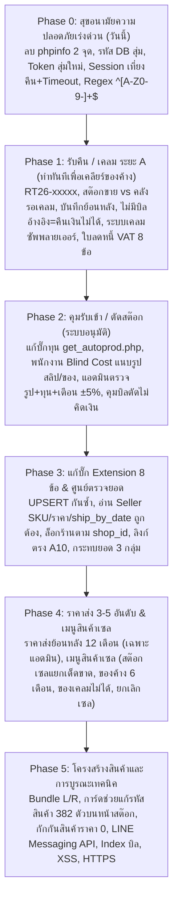

# แผนพัฒนาและยกระดับระบบ DD-Shop ฉบับปฏิบัติการจริง (Master Action Plan V5.0)
**วันที่ปรับปรุง:** 24 ตุลาคม 2026 (เวลา 13:25 น. อัปเดตตามมติเอกสารล่าสุด `รายการแก้และพัฒนาทั้งหมด_ส่งนักพัฒนา_24-10-2026.docx`)  
**สถานะ:** บูรณาการมติการตัดสินใจของเจ้าของร้านและผลการตรวจของนักวิเคราะห์ครบถ้วน 100% พร้อมเริ่มปฏิบัติการ  
**เป้าหมายสูงสุด:** **Zero-Downtime Guarantee — ร้านค้าเปิดทำการต่อเนื่องได้ 100% ไม่สะดุด ไม่หยุดรอ ไม่เกิดบัคขัดขวางงานขาย**  
**ระบบเป้าหมาย (Live System):** `http://ddaccessory.trueddns.com:24330/dd-shop/`  
**เซิร์ฟเวอร์ฐานข้อมูลและไฟล์:** QNAP NAS (`100.77.57.16:8083` / SMB `//100.77.57.16/Web/dd-shop/`)

---

## 🛡️ กฎเหล็กด้านความเสถียรและการส่งมอบงาน (Zero-Downtime Guarantee)

1. **การสำรองข้อมูล (Backup First):** Dump ฐานข้อมูล MySQL และ Zip ซอร์สโค้ดเก็บใน `c:\ddcar\_secure_backups` ก่อนแตะต้องไฟล์ทุกครั้ง
2. **ห้ามแตะต้องระบบระหว่างเวลาเปิดร้าน:** การ Deploy ขึ้น Live NAS จะทำ **นอกเวลาทำการ (ค่ำหลัง 19:00 น. หรือ เช้าก่อน 08:00 น.)** เท่านั้น เพื่อให้หน้าร้านขายของได้ต่อเนื่อง 100%
3. **ทดสอบด้วย 3 บัญชีทดสอบ:** แอดมิน / พนักงานขาย / ดูคลังสินค้า (ไม่ใช้บัญชีพนักงานจริง)
4. **Console (F12) ต้องไม่มีตัวแดง:** ตรวจสอบความถูกต้องทุกหน้าจอ
5. **เปลี่ยนเลขเวอร์ชันแคช (?v=...):** เพื่อให้เครื่องหน้าร้านดึงไฟล์ใหม่ทันทีโดยไม่ต้องกดล้างแคช
6. **กฎ "ตรวจผ่านก่อนเริ่ม Phase ถัดไป":** หากข้อใดยังไม่ผ่านการรับรองจากนักวิเคราะห์ ให้เลื่อนวัน ไม่มีการข้ามขั้นตอน

---

## 1. สรุป 3 มติเด็ดขาดของเจ้าของร้าน (Final Owner Decisions)

| เรื่อง | มติของเจ้าของร้าน (24/10/2026) | การนำไปปฏิบัติในระบบ |
|---|---|---|
| **1. กติกาพรีออเดอร์บนแพลตฟอร์ม** | **ใช้ 3 วิธีร่วมกัน (เรียงตามลำดับความสำคัญ):**<br>1) *กดเลือกเอง (ชนะทุกข้อ):* พนักงาน/แอดมินคลิกเปลี่ยนเป็น "พรีออเดอร์" หรือ "มีสต๊อก" ได้เสมอ พร้อมบันทึกผู้กดและเวลา<br>2) *ระยะเวลาจัดส่งจากแพลตฟอร์ม:* วันที่ต้องจัดส่ง (`ship_by_date`) ห่างจากวันสั่ง $\ge 7$ วัน = **พรีออเดอร์** (Extension ต้องอ่านฟิลด์นี้)<br>3) *อายุออเดอร์ & สต๊อก:* ออเดอร์ค้าง $\le 2$ วัน = มีสต๊อก, $\ge 4$ วัน = พรีออเดอร์, วันที่ 3 = "ต้องตรวจ" (ไฮไลต์ให้คนกดเลือก) และถ้าสต๊อกไม่พอให้ขึ้น "รอของ" | บรรจุฟังก์ชันอ่าน `ship_by_date` ใน Extension Content Scripts และเพิ่มคอลัมน์สถานะใน `platform_orders` พร้อมปุ่มสลับสถานะในศูนย์ตรวจยอด |
| **2. รูปแบบรหัสสินค้า (SKU) ใหม่ & ตัวช่วยแก้** | **เข้มงวด:** อนุญาตเฉพาะ `A–Z` (พิมพ์ใหญ่), `0–9`, และ `-` เท่านั้น **ไม่มีช่องว่างเด็ดขาด** (ไม่อนุญาต `_`, `.`, `/`) Regex: `^[A-Z0-9-]+$`<br>• ตอนนี้พบรหัสเดิมผิดกติกา **382 รายการ** (340 ตัวแก้ได้อัตโนมัติโดยตัดช่องว่าง+ทำตัวใหญ่, 42 ตัวต้องให้เจ้าของร้านตั้งใหม่)<br>• **หน้าเช็คสต๊อก:** เพิ่มการ์ด/ปุ่ม **"รหัสสินค้าต้องแก้"** ใต้ปุ่มจับคู่สินค้าออนไลน์ แสดง Badge 382 รายการ กดแล้วเปิดดูรหัสเดิม ไฮไลต์จุดผิด พร้อมปุ่ม *"ใช้รหัสแนะนำ"* เมื่อแก้เสร็จจะอัปเดตตารางจับคู่แพลตฟอร์ม บันทึกประวัติรหัสเดิม และเตือนพิมพ์บาร์โค้ดใหม่ | ปรับ Regex ในหน้าเพิ่ม/แก้สินค้า และ Backend PHP; สร้างการ์ดและ Modal ช่วยแก้ไขบน `web_stock.html` |
| **3. เกณฑ์สินค้าค้างสต๊อกสำหรับเข้าเซล** | **ค่าเริ่มต้น 6 เดือน (180 วัน)** ที่ไม่มียอดขาย โดยมีตัวกรองเลือกดู 6 เดือน หรือ 1 ปีได้<br>• สินค้าต้องรับเข้าคลังมาแล้วเกินระยะเวลาดังกล่าวด้วย (สินค้าเข้าใหม่ไม่นับเป็นของค้าง)<br>• เป็นระบบแนะนำ เจ้าของร้านจะเป็นผู้ติ๊กเลือกเองว่าจะนำชิ้นใดเข้าสต๊อกเซล | ใส่ Query กรองสินค้าในหน้าคัดเลือกสินค้าเข้าเซล ใน Phase 4 |

---

## 2. ตารางแผนงานบูรณาการ 6 ระยะ (Master Action Roadmap V5.0)



### สรุปรายละเอียดแต่ละ Phase:

#### **Phase 0 — ความปลอดภัยด่วน (วันนี้ 24 ต.ค. 2026)**
* **0.1 ลบ phpinfo:** ลบ `php/phpinfo.php` และ `/Web/phpinfo.php` ออกจาก NAS ทันที
* **0.2 เปลี่ยนรหัสฐานข้อมูล:** เปลี่ยนรหัสผ่าน MySQL เป็นรหัสสุ่มยาว ย้ายไฟล์คอนฟิกออกนอก Web Root และจำกัดการเชื่อมต่อเฉพาะภายใน
* **0.3 เปลี่ยน Extension Token:** สร้าง Secret Token สุ่มใหม่ (ไม่ใส่ในเอกสารหรือ URL) ส่งผ่าน Header `X-Extension-Token`
* **0.4 รหัสผ่านผู้ใช้:** บังคับ $\ge 8$ ตัวอักษร, แฮชด้วย `password_hash()`, เปลี่ยนรหัสผ่านบัญชีพนักงานที่เคยใช้ทดสอบ, สร้าง 3 บัญชีทดสอบแยกสิทธิ์
* **0.5 Session:** หมดอายุ ณ เวลาเที่ยงคืน (23:59:59) และตัดออกจากระบบอัตโนมัติหากไม่ใช้งานติดต่อกัน 30–60 นาที
* **0.6 บังคับรูปแบบรหัสสินค้าใหม่:** บังคับ Regex `^[A-Z0-9-]+$` ตอนเพิ่ม/แก้ไขสินค้าทันที

#### **Phase 1 — รับคืน / เคลม ระยะ A (ทำทันทีเพื่อเคลียร์ของค้างที่ร้าน — 25 ต.ค. 2026)**
* **รหัสเอกสาร:** ออกใบรับคืน `RT26-xxxxx` เรียงลำดับต่อเนื่อง ไม่แก้ไขหรือแตะต้องบิลขายเดิม ปิดปุ่ม "คืนสินค้า" เดิมในรายงานบิล
* **การอ้างอิง:** ค้นหาด้วยเลขบิลขาย หรือ เลขคำสั่งซื้อแพลตฟอร์ม ดึงรายการสินค้า ลูกค้า และ VAT อัตโนมัติ **(มติเพิ่ม: หากไม่มีเลขอ้างอิง สามารถบันทึกเพื่อคุมสต๊อกได้เท่านั้น แต่จะคืนเงินและออกใบลดหนี้ไม่ได้เด็ดขาด)**
* **แยก 2 ทาง:** 1) สภาพดี ➔ คืนเข้าสต๊อกขาย 2) แตกหัก/เสียหาย ➔ เข้า **"คลังรอเคลม (Quarantine)"**
* **ช่องพิมพ์เหตุผลอิสระ:** รองรับการลงย้อนหลังเพื่อเคลียร์ของค้างที่ร้าน + บังคับแนบรูปถ่ายสินค้า + บันทึกผู้รับคืนและผู้อนุมัติ
* **ระบบเคลมซัพพลายเออร์ (เมื่อเข้าคลังรอเคลม):**
  - บังคับแนบรูปความเสียหาย, เสนอชื่อซัพพลายเออร์ล่าสุดของสินค้านั้น
  - วงจรชีวิตเคลม: `รอส่งเคลม -> ส่งเคลมแล้ว (รอผล) -> ปิด`
  - หน้าจอ **"เคลมค้างรับ"** เรียงลำดับตามจำนวนวันที่ค้างนานที่สุด
  - ผลเคลม: ได้ของใหม่ ➔ คืนเข้าสต๊อกขายอัตโนมัติ, ได้เงิน/ใบลดหนี้ ➔ ปิดเคลมพร้อมยอดเงิน, เคลมไม่ได้ ➔ ย้ายไปเมนูสินค้าเซล หรือ ทุบทิ้ง (พร้อมรูปและแอดมินอนุมัติ)
* **ใบลดหนี้ VAT:** เก็บข้อมูลครบ 8 ข้อตามเกณฑ์สรรพากร (รอผู้ทำบัญชียืนยันแบบฟอร์มก่อนพิมพ์ให้ลูกค้า)

#### **Phase 2 — คุมรับเข้า / ตัดสต๊อก ระบบอนุมัติ (26 ต.ค. 2026)**
* **แก้บั๊กก่อนเริ่ม:** ปลดคอมเมนต์ต้นทุนใน `get_autoprod.php` พร้อมคุมสิทธิ์ Session (ส่งเฉพาะแอดมิน)
* **พนักงานลงรับของ:** สินค้า, จำนวน, ซัพ, เลขบิล, บังคับแนบรูปสลิปและรูปสินค้าจริง, **Blind Cost** ไม่เห็นและไม่กรอกทุน
* **สถานะรออนุมัติ:** สต๊อกยังไม่เพิ่ม, แสดงตัวเลข Badge แดงแจ้งเตือนบนเมนูผู้บริหาร, สรุปในรายงานประจำวัน
* **แอดมิน/เจ้าของร้านตรวจ:** เทียบรูปกับรายการ (รุ่น/สี/ไซส์/จำนวน), เห็นทุนล่าสุด+วันที่+ซัพเดิม, กรอกยืนยันทุน, **ระบบเตือนอัจฉริยะหากทุนต่างเกิน ±5%**
* **อนุมัติ / ตีกลับ:** อนุมัติ ➔ สต๊อกเข้าจริง / ตีกลับ ➔ ระบุเหตุผลเด้งกลับไปพนักงานแก้
* **แยกหน้าที่:** พนักงานขาย ขายได้ แต่การปรับลดสต๊อก / ตัดไม่คิดเงิน (Write-off) / แก้บิล ต้องผ่านอนุมัติแอดมินเท่านั้น

#### **Phase 3 — แก้บั๊ก Chrome Extension 8 ข้อ & ศูนย์ตรวจยอด (27 ต.ค. 2026)**
* **3.1 กันบันทึกซ้ำ:** บันทึกแบบ `UPSERT` ตาม `order_sn` + รหัสสินค้า + สคริปต์ล้าง 77 แถวเดิมที่ซ้ำ
* **3.2 ล็อกร้าน:** อ่าน `shop_id` จาก Seller Center อัตโนมัติ บันทึกแยกร้าน KingKong และ แต่งระเบิด
* **3.3 Shopee:** แก้ตัวดึงข้อมูลให้อ่าน Seller SKU, ราคาจริง, `item_id`, `model_id` ครบถ้วน
* **3.4 TikTok:** แก้ตัวดึงข้อมูลไม่ให้อ่านเป็น JSON ดิบ และอ่าน Seller SKU ตรงช่อง
* **3.5 Lazada:** แก้ตัวดึงข้อมูลให้อ่าน Seller SKU แทนรหัสแพลตฟอร์ม
* **3.6 กติกาพรีออเดอร์:** ดึงฟิลด์ `ship_by_date` มาคำนวณตาม 3 กติกาของเจ้าของร้าน แยกยอด "พร้อมส่ง" ออกจาก "พรีออเดอร์"
* **3.7 สิทธิ์ Extension:** จำกัด Host Permissions ใน `manifest.json` เฉพาะ Seller Center และเซิร์ฟเวอร์ร้าน
* **3.8 ลิงก์ตรง & รูปภาพ:** สร้างลิงก์ตรงไปยังสินค้า (`shopee.co.th/product/{shop_id}/{item_id}`) และดึงภาพ Thumbnail
* **ศูนย์ตรวจยอด:** กระทบยอด 3 กลุ่ม ซิงค์เช้า-เย็น วันละ 2 รอบ

#### **Phase 4 — ราคาส่ง 3–5 อันดับ & เมนูสินค้าเซล (28 ต.ค. 2026)**
* **4.1 ราคาส่งต่ำสุด 3–5 อันดับ:** คำนวณจากบิลขายส่ง 12 เดือน (ราคาล่าสุดต่อร้าน เรียงต่ำไปสูง ไม่เกิน 5 อันดับ), แสดงบนการ์ดสต๊อก + หน้าขาย POS เมื่อเลือกลูกค้าขายส่ง, เฉพาะสิทธิ์แอดมิน/เจ้าของร้าน (ตัดที่ API), เตือนเมื่อขายต่ำกว่าอันดับ 1
* **4.2 เมนูใหม่ "สินค้าเซล" (Clearance):**
  - ที่มา 2 ทาง: ของค้างสต๊อกเกิน 6 เดือน (180 วัน) + ของชำรุดเสียหายที่เคลมซัพพลายเออร์ไม่ได้
  - สต๊อกเซลแยกกองเด็ดขาด ไม่ปนสต๊อกปกติ, แอดมินตั้งราคาเซล (เห็นทุนและกำไร/ขาดทุน)
  - หน้ารวมสินค้าเซลสำหรับส่งโปรโมท + ตัวช่วยเลือกของค้าง 6 เดือน / 1 ปี
  - หน้าขาย POS แยกบรรทัดสินค้าเซล ตัดจากสต๊อกเซล
  - ยกเลิกเซล: ของค้างย้ายกลับสต๊อกปกติได้ / ส่วนของเสียหายย้ายกลับสต๊อกปกติไม่ได้ (ไปได้แค่ทุบทิ้ง)

#### **Phase 5 — โครงสร้างสินค้าและการบูรณะเทคนิคระบบ (29–31 ต.ค. 2026)**
* **5.1 สินค้าคู่ ซ้าย/ขวา (Bundle L/R):** ขายชุด 1 = ตัดซ้าย 1 + ขวา 1, สต๊อกพร้อมขาย = `MIN(ซ้าย, ขวา)`
* **5.2 การ์ดช่วยแก้รหัสสินค้า 382 รายการ (บนหน้าเช็คสต๊อก):**
  - แสดงการ์ด/ปุ่ม "รหัสสินค้าต้องแก้" ใต้ปุ่มจับคู่สินค้าออนไลน์ พร้อม Badge 382 รายการ
  - กดเปิดดูรายการ ไฮไลต์จุดผิด พร้อมปุ่ม "ใช้รหัสแนะนำ" (แก้ได้ทันที 340 ตัว)
  - อัปเดตตารางจับคู่แพลตฟอร์ม บันทึกประวัติรหัสเดิม และแจ้งเตือนพิมพ์บาร์โค้ดใหม่
* **5.3 ควบคุมราคาสินค้า:** ห้ามขายราคา 0 (260 ตัว) เว้นแอดมิน, เตือนราคาส่ง > ปลีก (13 ตัว)
* **5.4 สรุปยอดขาย:** การ์ดตัดไม่คิดเงินรายเดือน/รายปี + กดดูรายละเอียดบิล 5 บิล ฿17,258 พร้อมผู้ทำและเหตุผล
* **5.5 รายงานประจำวันเจ้าของร้าน:** สรุปยอดขาย กำไร ตัดไม่คิดเงิน รออนุมัติ เคลมค้างรับ แจ้งเตือนผ่าน **LINE Messaging API** (เนื่องจาก LINE Notify ยุติการให้บริการแล้ว)
* **5.6 ต้นทุนฝั่ง API:** ตัดทุน/กำไร/writeoff ออกจาก API ตาม Session Role
* **5.7 ป้องกัน XSS:** ครอบ `escapeHtml()` ใน `navbar.js` ใช้ทุกจุดแสดงชื่อสินค้า/ลูกค้า/หมายเหตุ
* **5.8 รวมชุดไลบรารี:** รวม jQuery/Bootstrap เป็นชุดเดียวและเก็บในเซิร์ฟเวอร์ร้าน (Local NAS)
* **5.9 ความเร็ว Query:** สร้าง Composite Index บน `sale_order` + Pagination LIMIT 30 บิล
* **5.10 DOM Collision:** แก้ไข ID ซ้ำ `ipt-65087` ในหน้ารายงานสินค้าเข้าหน้าร้าน
* **5.11 HTTPS:** ติดตั้ง SSL Certificate สำหรับ ddaccessory.trueddns.com:24330
* **5.12 รับคืน/เคลม ระยะ B:** ปรับแบบฟอร์มใบลดหนี้ตามผู้ทำบัญชี + ส่งยอดเข้ารายงานภาษีขาย

---

## 3. สิ่งที่คงไว้ตามเดิม (เจ้าของร้านตัดสินแล้ว ไม่ต้องแก้)
1. **ลำดับขั้นตอนในหน้าคิดเงิน:** คงลำดับเดิมไว้คือ `ส่วนลด ➔ รับเงิน ➔ คำนวณเงินทอน` — ไม่ทำส่วนลดอัตโนมัติจากยอดรับเงิน
2. **รูปภาพสินค้า (แสดงผล 570 จาก 12,985 รายการ):** ระบบแสดงภาพทำงานถูกต้องแล้ว รายการที่ไม่มีรูปคือสินค้าที่ทางร้านยังไม่ได้ถ่ายรูปบันทึกเข้าฐานข้อมูล ถือเป็นงานภายในของร้าน ไม่ใช่ข้อผิดพลาดของโปรแกรม

---

## 4. แผนงานส่งมอบและการันตีความปลอดภัย (Step-by-step Execution)

```text
[ ค่ำวันนี้: ดำเนินการ Phase 0 (ด่วนวันนี้) นอกเวลาทำการ ]
  ├── 1. สำรองฐานข้อมูล ddcar_backup_20261024_phase0.sql.gz
  ├── 2. ลบ phpinfo.php ทั้ง 2 จุดบนเซิร์ฟเวอร์
  ├── 3. ปรับปรุง auth_guard.php: Session หมดอายุเที่ยงคืน + Inactivity Timeout 30-60 นาที
  ├── 4. บังคับ Regex รหัสสินค้าใหม่ ^[A-Z0-9-]+$
  └── 5. ทดสอบด้วย 3 บัญชีทดสอบ ส่งรายงานพร้อมหลักฐานบรรทัดโค้ดให้ Analyst

[ พรุ่งนี้: ดำเนินการ Phase 1 (ระบบรับคืน / เคลม ระยะ A) ]
  ├── 1. สร้างหน้าเว็บ web_return_claim.html + เอกสาร RT26-xxxxx
  ├── 2. สร้างระบบแยก 2 ทาง (สต๊อกขาย vs คลังรอเคลม) + เคลมซัพพลายเออร์
  ├── 3. เชื่อมโยงค้นหาบิลเดิม (ถ้าไม่มีบิล = คืนเงินไม่ได้) + รองรับบันทึกย้อนหลัง
  └── 4. ทดสอบความถูกต้องบนเครื่อง Staging ก่อนขึ้นระบบจริงนอกเวลาทำการ
```
