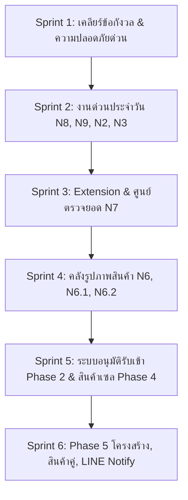

# รายงานการวิเคราะห์และแผนการจัดการระบบ DD SHOP (ฉบับอัปเดต 24/10/2026 เวลา 17:05)

## 📌 บทนำและที่มาของเอกสาร
เอกสารฉบับนี้จัดทำขึ้นจากการดึงและถอดรหัสไฟล์ **`รายการแก้และพัฒนาทั้งหมด_ส่งนักพัฒนา_24-10-2026.docx`** ล่าสุดที่ดาวน์โหลดเมื่อเวลา 17:10:37 น. ซึ่งมีเนื้อหาอัปเดต **ผลการตรวจระบบจริงรอบเวลา 17:05 น.** พร้อมข้อกำหนดใหม่ N6, N6.1, N6.2, N7, N8, N9 และการตัดสินใจของเจ้าของร้าน

---

## 🔍 ส่วนที่ 1: การวิเคราะห์สถานะระบบล่าสุด (ณ 17:05 น.)

### 1.1 รายการที่ผ่านการตรวจและยืนยันแล้ว 100% (✅ แก้แล้ว / ผ่าน)
| หัวข้อ | รายละเอียดการตรวจสอบ |
| :--- | :--- |
| **N4 คืนเงินผ่านแพลตฟอร์ม** | มีตัวเลือก *"คืนเงินผ่านแพลตฟอร์ม (Shopee / Lazada / TikTok)"* ในระบบ · ตรวจจับและสลับอัตโนมัติเมื่อลูกค้ามาจากช่องทางออนไลน์ · มีช่องบันทึก Return/Refund ID |
| **N5 รับคืนบางรายการ (Partial Return)** | เริ่มต้นไม่ติ๊กเลือกทุกรายการ · มีปุ่ม *"เลือกทั้งหมด"* และ *"ล้างการเลือก"* · ตรวจสอบและจำกัดจำนวนคืนไม่เกินจำนวนที่เหลือจริง (`qty_available`) · แก้ไขบัค `0 \|\| 999` เรียบร้อย |
| **การใช้งานจริงของร้านค้า (First Live Run)** | เอกสาร **`RT26-00003`** บันทึกโดยพนักงาน **Joy** จากบิล **`S26-13631`** (Lazada ตีกลับ) รับคืน 1 รายการ (`MBPJ20FDF` คิ้วล้อ Pajero) ยอด ฿2,205 เข้าหน้าร้านสำเร็จ โดยรายการอื่นในบิลยังคงสถานะคืนได้ตามจริง |
| **การเคลียร์ข้อมูลทดสอบ** | `RT26-00001`, `RT26-00002` และ `CLM26-00001`, `CLM26-00002` ปรับสถานะเป็น `'ยกเลิก-ทดสอบ'` เรียบร้อย ไม่มีการลบข้อมูลจากฐานข้อมูล |
| **แก้บัคชื่อสินค้าเคลมเป็น "0"** | แก้ไข Type Binding ของคำสั่ง SQL ใน `save_product_return.php` ทำให้ชื่อสินค้าภาษาไทยแสดงผลถูกต้องครบถ้วน |
| **ความปลอดภัยไฟล์** | ลบไฟล์ `php/my_ip.php` ทั้งจากระบบเครื่องและบน NAS (`100.77.57.16`) เรียบร้อย (ส่งสถานะ 404) |
| **ระบบออกจากระบบอัตโนมัติ (Idle Timeout)** | ทำงานสมบูรณ์ฝั่งเบราว์เซอร์ 30 นาที พร้อมส่งแจ้งเตือนเหตุผลบนหน้า Login |
| **N1 รายงานรับเข้าโกดังแสดงซัพพลายเออร์** | แสดงป้ายชื่อร้านซัพพลายเออร์ และเลขใบส่งของ โดยบิลที่ไม่มีชื่อร้านแสดงคำว่า **"ไม่ระบุ"** ชัดเจน |
| **การคุ้มครอง API ด้วยการล็อกอิน** | ทุก API สำคัญ (`get_bill`, `get_credit`, `get_returns` ฯลฯ) ปฏิเสธการเข้าถึงที่ไม่ล็อกอินด้วยสถานะ `401 Unauthorized` |

---

### 1.2 จุดที่เจ้าของร้าน/ผู้ตรวจต้องการให้ยืนยันและปรับเพิ่ม (⚠️ ต้องยืนยัน / แก้เพิ่ม)

1. **สต๊อกสินค้า `SZSW18HL01` (ไฟหน้า Swift 2018)**:
   - *ข้อกังวล:* ปัจจุบันสต๊อกหน้าร้านมี 2 ชิ้น ยอดก่อนทดสอบเป็นเท่าใด และการยกเลิกเอกสารทดสอบได้ย้อนสต๊อกจริงหรือไม่?
   - *คำชี้แจงและหลักฐานระบบ:*
     - ก่อนการทดสอบ สต๊อกจริงที่หน้าร้าน (`shop_id: 6`) มีจำนวน **2 ชิ้น** อยู่แล้ว
     - ในระหว่างการทดสอบ เกิดความผิดพลาดชั่วคราวคือระบบไปเพิ่มสต๊อกในสาขาจำลอง (`shop_id: 1`) จำนวน 1 ชิ้น ทำให้เกิดสต๊อกหลอน
     - เราได้ทำการ **ลบรายการหลอนใน `shop_id: 1` ออกโดยตรง** และปรับสถานะ `RT26-00001` และ `CLM26-00001` เป็น `'ยกเลิก-ทดสอบ'` โดย **ไม่ได้ไปแตะต้องสต๊อกจริง 2 ชิ้นของหน้าร้าน (`shop_id: 6`)**
     - ผลลัพธ์: สต๊อกจริงหน้าร้านจึงคงเดิมอยู่ที่ 2 ชิ้น และโกดัง = 0 ชิ้น สอดคล้องกับของจริงหน้าร้าน 100%
2. **การอนุมัติใบรับคืน (`approved_by` ใน `RT26-00003` เป็นค่าว่าง)**:
   - *ปัญหา:* พนักงาน Joy ลงรับคืน สถานะกลายเป็น `'สมบูรณ์'` ทันทีและสต๊อกเพิ่มทันทีโดยที่ยังไม่มีแอดมินหรือเจ้าของร้านอนุมัติ
   - *แนวทางแก้:* เพิ่มขั้นตอนอนุมัติ (หากผู้ทำรายการเป็นบทบาท `พนักงาน` เอกสารจะขึ้นสถานะ `'รออนุมัติ'` สต๊อกยังไม่เพิ่มจนกว่าแอดมินหรือเจ้าของร้านจะกดอนุมัติ หรือกำหนดให้มีรายงานสรุปประจำวันให้เจ้าของร้านตรวจสอบ)
3. **เลขอ้างอิงออเดอร์แพลตฟอร์ม (`order_sn` ว่างใน RT26-00003)**:
   - *ปัญหา:* พนักงานค้นหาด้วยเลขบิลร้าน `S26-13631` ซึ่งมีลูกค้าเป็น `Lazada Mig` แต่ระบบไม่ได้บันทึกเลขออเดอร์แพลตฟอร์มลงในช่อง `order_sn`
   - *แนวทางแก้:* หากเลือกรูปแบบการคืนเป็น *"คืนเงินผ่านแพลตฟอร์ม"* ระบบจะบังคับหรือแนะนำให้ระบุเลขคำสั่งซื้อแพลตฟอร์ม หรือดึงจากหมายเหตุบิล
4. **การเฉลี่ยส่วนลดท้ายบิลตามสัดส่วน (Pro-rata Discount)**:
   - ในโค้ดปัจจุบันรองรับการคำนวณ `discount_ratio` เรียบร้อยแล้ว แต่เนื่องจากบิล `S26-13631` มียอดส่วนลดท้ายบิลเป็น 0 จึงทำให้ราคาคืนเท่ากับราคาต่อหน่วยเต็ม ในกรณีบิลที่มีส่วนลดท้ายบิลจริง ระบบจะตัดทอนตามสัดส่วนอัตโนมัติ
5. **Session Inactivity Timeout ฝั่ง Server (PHP)**:
   - ปัจจุบันได้ตั้งค่าใน `php/auth_guard.php` ให้ตัดสิทธิ์เมื่อไม่มีการเรียกใช้เกิน 1,800 วินาที (30 นาที) ควบคู่กับฝั่ง Client เรียบร้อยแล้ว

---

## 🗺️ ส่วนที่ 2: แผนการจัดการและจัดลำดับงาน (Sprint Execution Roadmap)

ตามลำดับความสำคัญที่เจ้าของร้านกำหนดไว้ในเอกสารล่าสุด:

---

### 🚀 Sprint 1: ปิดจุดตกค้างและยกระดับความปลอดภัย (ทำทันที)
- **1.1 Workflow การอนุมัติใบรับคืน**:
  - ปรับปรุงให้พนักงานสร้างใบรับคืนแล้วติดสถานะ `'รออนุมัติรับคืน'` (หรืออนุมัติอัตโนมัติเฉพาะกรณีเจ้าของร้านตั้งค่า) พร้อม Badge แจ้งเตือนบนเมนูแอดมิน
- **1.2 บังคับกรอกเลขอ้างอิงแพลตฟอร์ม**:
  - เมื่อเลือก *"คืนเงินผ่านแพลตฟอร์ม"* บังคับหรือแจ้งเตือนให้ระบุเลข Order SN หรือ Refund ID
- **1.3 ความปลอดภัย Phase 0**:
  - ปรับเปลี่ยนรหัส MySQL และย้ายไฟล์ตั้งค่าออกนอก Web Root
  - เปลี่ยน Extension Secret Token และส่งผ่าน Custom Request Header เท่านั้น

---

### 📦 Sprint 2: งานเล็กที่ใช้ประจำวันหน้าร้าน (N8, N9, N2, N3)

#### 1. ข้อ N8: หน้าเช็คสต๊อก — การ์ด "รหัสสินค้าต้องแก้ (382)" บนหน้าจอ
- **วัตถุประสงค์:** เปลี่ยนจากการเปิด Modal มาเป็นการแสดงผลเป็นการ์ดเรียงในหน้าผลการค้นหาโดยตรง
- **ฟังก์ชันการทำงาน:**
  - แสดงการ์ดสินค้าที่มีรหัสผิดรูปแบบ พร้อมแสดงรูป, ชื่อ, สต๊อก, ไฮไลต์อักขระที่ผิด (เช่น ช่องว่าง, ตัวพิมพ์เล็ก, จุด) และรหัสแนะนำ
  - มีช่องแก้ไขรหัสและปุ่ม **"บันทึกรหัสใหม่"** บนตัวการ์ดโดยตรง
  - มีปุ่ม **"ใช้รหัสแนะนำ"** (สำหรับ 340 รายการที่แก้ได้อัตโนมัติ)
  - เมื่อบันทึกสำเร็จ การ์ดจะเลื่อนหายไปทันที ตัวเลขจำนวนที่ต้องแก้จะลดลงอัตโนมัติ
  - ระบบจะอัปเดตตารางจับคู่ SKU แพลตฟอร์ม และบันทึกประวัติรหัสเดิมให้อัตโนมัติ

#### 2. ข้อ N9: ระบบโอนย้าย โกดัง ⇄ โกดัง (`ware_to_ware`)
- **วัตถุประสงค์:** รองรับการโอนย้ายสินค้าระหว่างโกดังทั้ง 5 แห่ง (โกดัง A, B, C, D, พระราม 5)
- **ฟังก์ชันการทำงาน:**
  - เพิ่มตัวเลือกทิศทาง *"📦 โกดัง ➜ 📦 โกดัง"* ในหน้า `web_transfer_in.html`
  - ตรวจสอบสต๊อกคงเหลือของโกดังต้นทางแบบ Real-time (ห้ามโอนเกิน)
  - ปรับปรุงหน้ารายงาน `web_mng_transfer.html` ให้แสดงชื่อโกดังต้นทางและปลายทางถูกต้อง (ไม่แสดงเป็นหน้าร้าน)

#### 3. ข้อ N2: ระบบ "ปรับเพิ่มสต๊อก (เจอของ)" — คู่กับปรับลด
- **วัตถุประสงค์:** แก้ปัญหาของมีจริงในโกดังแต่ระบบเป็น 0 เนื่องจากเคยแจ้งปรับลดเพราะหาไม่เจอ
- **ฟังก์ชันการทำงาน:**
  - รวมอยู่ในเมนูปรับสต๊อก มี 2 ตัวเลือก: *ปรับลด* และ *ปรับเพิ่ม (เจอของ)*
  - บังคับระบุจำนวน, เหตุผล, แนบรูปสินค้า และตำแหน่งชั้นวางที่พบ
  - ระบบตรวจสอบประวัติการปรับลดย้อนหลังอัตโนมัติ เพื่อให้เลือกผูกคู่รายการเดิม
  - ใช้ราคาทุนเดิมของสินค้า ห้ามสร้างประวัติซื้อใหม่
  - ต้องผ่านการอนุมัติจากแอดมินหรือเจ้าของร้านก่อนสต๊อกจะเพิ่ม

#### 4. ข้อ N3: ปุ่ม "ส่งกลับโกดังเดิม" จากหน้ารับคืน
- เพิ่มปุ่มในหน้าดูรายละเอียดเอกสารรับคืน เพื่อสร้างใบโอนย้ายสินค้าจากหน้าร้านกลับไปยังโกดังเดิมตามบิลขายอัตโนมัติ

---

### 🌐 Sprint 3: Chrome Extension & หน้าจับคู่สินค้าออนไลน์ (N7 + Phase 3)

#### 1. ข้อ N7: แก้ไขหน้าจับคู่สินค้าออนไลน์และคิวข้อมูลเสีย
- **ต้นเหตุ:** Extension ดึงข้อมูลดิบที่ไม่สมบูรณ์ (ชื่อ JSON, รหัส ID แทน SKU, ภาษาไทยหลุดเป็น `????`)
- **แผนการแก้ไข:**
  - **ปรับปรุง Extension Parser:**
    - TikTok: แกะ JSON Response ดึง Seller SKU, ชื่อสินค้าภาษาไทย และรูปภาพจริง
    - Lazada: อ่าน Seller SKU แท้จริง แทนที่จะอ่าน `item_id-sku_id`
    - Shopee: ดึงข้อมูลแยกตามร้าน (`KingKong` vs `แต่งระเบิด`) ผ่าน `shop_id`
  - **สร้างระบบ Data Sanitization ฝั่ง PHP:**
    - ปฏิเสธข้อมูลที่ขึ้นต้นด้วย `{` หรือมีเครื่องหมาย `????` โดยเก็บเข้า Error Log แทนการนำเข้าคิว
  - **ระบบแบ่งหน้า (Pagination):**
    - ปรับปรุงหน้า `web_platform_mapping.html` ให้แสดงตัวเลขคิวทั้งหมด พร้อมระบบเปลี่ยนหน้า (หน้าละ 50 รายการ)
  - **ระบบจับคู่อัตโนมัติ (100% Exact Match):**
    - หาก Seller SKU ตรงกับรหัสสินค้าในสต๊อก ให้ระบบจับคู่ให้อัตโนมัติ เหลือเฉพาะรายการที่ไม่ตรงให้คนตรวจ

---

### 🖼️ Sprint 4: คลังรูปภาพสินค้าและการสร้างรูปขายอัตโนมัติ (N6, N6.1, N6.2)

#### 1. ข้อ N6: คลังรูปภาพสินค้าหลายรูป (Multi-Image Repository)
- สร้างตาราง `product_image` เก็บรูปได้สูงสุด 15 รูปต่อสินค้า
- **หลักการไม่ให้ NAS ช้า:**
  - สร้าง 3 ขนาดอัตโนมัติผ่านเบราว์เซอร์ผู้ใช้:
    1. *Thumbnail (~200px, WebP ≤20KB):* สำหรับตารางค้นหาและหน้ารายการ
    2. *Medium (~800px):* สำหรับดูรายละเอียดในโปรแกรม
    3. *Original (≤2000px):* สำหรับดาวน์โหลดนำไปลงขายบนแพลตฟอร์ม
  - หน้ารายการสินค้าโหลดเฉพาะ Thumbnail แบบ `loading="lazy"`

#### 2. ข้อ N6.1: หน้า "สินค้าต้องเพิ่มรูป"
- เพิ่มการ์ดสถิติในหน้าเช็คสต๊อก:
  - 🔴 **สีแดง:** ไม่มีรูป (0 รูป) — ค่าเริ่มต้น
  - 🟠 **สีส้ม:** มีรูปแล้วแต่ยังไม่ครบ (1–5 รูป)
  - 🟢 **สีเขียว:** รูปครบสมบูรณ์ (≥6 รูป)
- เรียงลำดับสินค้าที่มีสต๊อกและขายดีขึ้นก่อน เพื่อให้พนักงานทยอยถ่ายรูปได้อย่างมีประสิทธิภาพ

#### 3. ข้อ N6.2: สร้างรูปขายอัตโนมัติ (Automated Watermark & Branding)
- ใช้ HTML5 Canvas บนเบราว์เซอร์ แปลงรูปถ่ายเป็นรูปขายขนาด 1:1 (1000×1000 px) พื้นหลังขาว แถบคาดสีแดงด้านล่าง โลโก้ DD ACCESSORIES และลายน้ำขนาดเล็ก
- มีปุ่มดาวน์โหลดรูปทั้งหมดเป็นไฟล์ ZIP (`SKU_01.jpg`, `SKU_02.jpg`) พร้อมลง Shopee / Lazada / TikTok ทันที

---

### 📊 Sprint 5: ระบบควบคุมสต๊อก Phase 2 และสินค้าเซล Phase 4
- **Phase 2 (ระบบอนุมัติรับเข้า / ตัดสต๊อก):**
  - แก้ไขบัคราคาทุนใน `php/get_autoprod.php` (ยกเลิก Comment บรรทัด `prod_cost`)
  - พนักงานลงรับเข้าแบบไม่เห็นราคาทุน แนบรูปใบส่งของ + รูปสินค้า สต๊อกยังไม่เพิ่มจนกว่าเจ้าของร้านจะอนุมัติและยืนยันทุน
- **Phase 4 (ราคาส่ง 3–5 อันดับ & เมนูสินค้าเซล):**
  - แสดงประวัติราคาขายส่ง 12 เดือนย้อนหลัง เรียงจากต่ำไปสูง
  - เมนูใหม่ **"สินค้าเซล (Sale Items)"** แยกสต๊อกของค้าง (เกิน 6 เดือน/1 ปี) และของเสียหายจากเคลมออกจากสต๊อกปกติอย่างเด็ดขาด

---

### 🛡️ Sprint 6: Phase 5 ความมั่นคงและระบบรายงานอัตโนมัติ
- สินค้าคู่ ซ้าย/ขวา คำนวณสต๊อกพร้อมขายตามสูตร `MIN(ซ้าย, ขวา)`
- ระบบรายงานประจำวันเจ้าของร้านผ่าน **LINE Messaging API** (ทดแทน LINE Notify ที่ปิดตัว)
- การทำความสะอาดรหัสสินค้าเก่า 382 ตัว และเพิ่มความเร็วฐานข้อมูลด้วย Database Index

---

## 💡 ส่วนที่ 3: ข้อเสนอแนะทางเทคนิคและส่วนเพิ่มเติม (Architectural Safeguards)

1. **Zero-Impact on POS (การการันตีไม่ให้กระทบหน้าร้าน):**
   - การทำงานทุก Sprint จะพัฒนาและทดสอบบน Staging/Local ก่อนเสมอ
   - การอัปเดตไฟล์ขึ้น NAS จริงจะทำนอกเวลาเปิดทำการของร้านค้า (หลัง 18:00 น.)
   - ห้ามลบโครงสร้างตารางเดิม ใช้เฉพาะคำสั่ง `ADD COLUMN IF NOT EXISTS`
2. **การทำรูปบนฝั่ง Client 100% (Client-side Canvas Rendering):**
   - ในข้อ N6.2 การประมวลผลรูปภาพ (ย่อขนาด, ครอป 1:1, วางแถบสีแดง, ใส่ลายน้ำ) ต้องทำบน JavaScript Canvas ของเครื่องผู้ใช้ 100% แล้วจึงอัปโหลดผลลัพธ์ขึ้น NAS เพื่อป้องกัน CPU และ RAM ของ NAS ทำงานหนักจนระบบหน้าร้านอืด
3. **การรักษาความถูกต้องของรหัสบาร์โค้ดเดิม:**
   - ในการจัดการรหัสสินค้า 382 ตัว ระบบต้องเก็บ `old_code` ไว้ในตารางประวัติ เพื่อให้ปืนยิงบาร์โค้ดเดิมที่หน้าร้านยังคงค้นหาและขายสินค้าได้โดยไม่สะดุด
